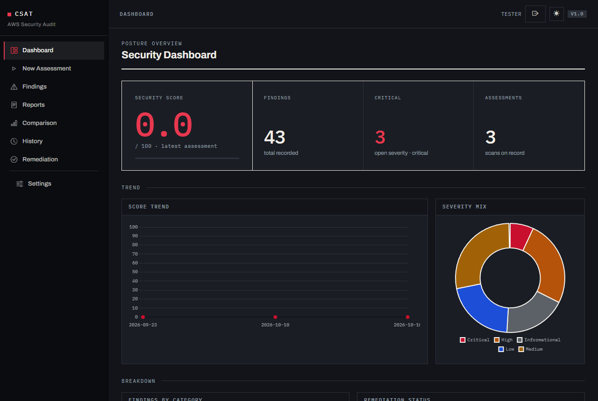
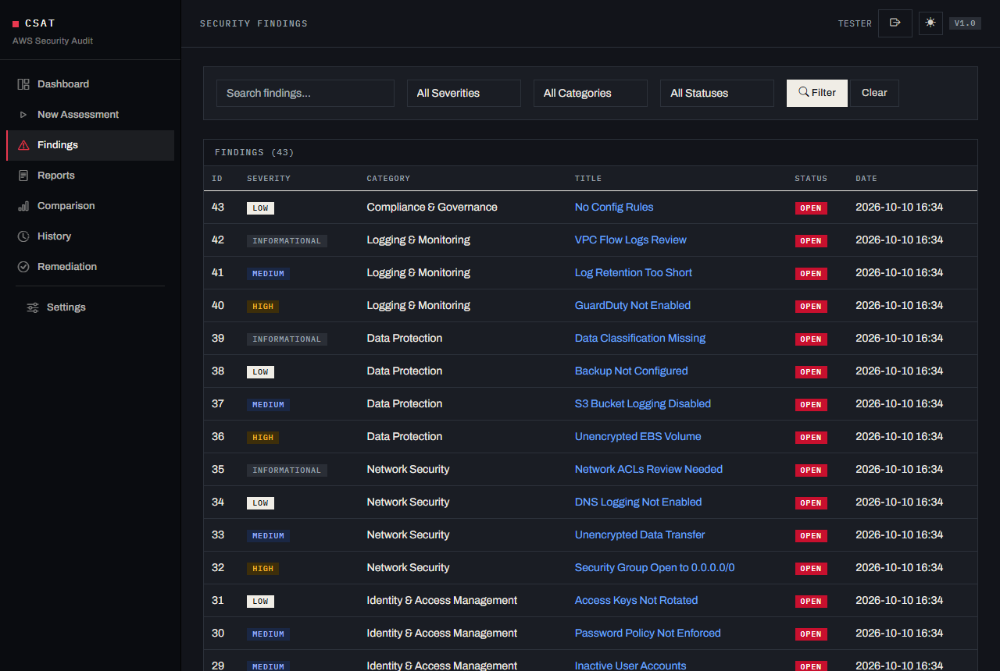
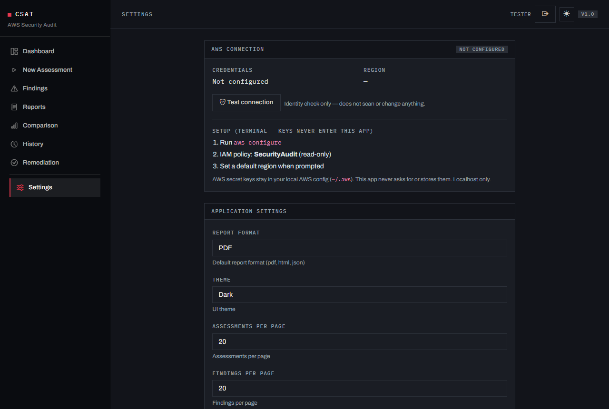

# AWS Cloud Security Audit Tool

[](https://github.com/r0n-afk/aws-cloud-security-audit-tool/actions/workflows/tests.yml)
[](https://www.python.org/downloads/)
[](LICENSE)

A self-hosted web application that audits AWS accounts with **Prowler + ScoutSuite together**, removes redundant findings across the tool, and produces professional HTML / PDF / JSON reports with score tracking and scan comparison.

**Status:** student showcase project (2 contributors) · **Python 3.10–3.14** · Windows / Linux / macOS

**Authors:** [Rohan Kolte (@r0n-afk)](https://github.com/r0n-afk) · [genrex-bot](https://github.com/genrex-bot)

---

## Features

- **Real AWS primary** — default scanner mode is **AWS** (Prowler + ScoutSuite when installed, boto3 fallback). Missing credentials fail hard with a clear error — no silent demo.
- **AWS connection panel** — Settings shows credential status, region, and Test connection (STS `GetCallerIdentity` only); keys stay in `~/.aws` (never entered into the app).
- **Findings workspace** — search, filter, sort; severity badges; resource ARN and control ID; remediation status tracking.
- **Assessment history & comparison** — score trend, severity deltas, side-by-side view.
- **Optional AI** (OFF by default) — finding summaries, remediation advice, risk prioritization, natural-language Q&A against stored findings. Any OpenAI-compatible endpoint (incl. local Ollama). **HTTPS-only** base URL (local Ollama exception). Base URL + token required to enable. Rate limited: 10/min · 100/day · 1 concurrent.
- **Local offline auth** — first-run `/auth/setup` creates the single account (hashed password in SQLite); login required every session; localhost binding only.

## Screenshots

| Dashboard | Findings |
|-----------|----------|
|  |  |



## Quick start

### Windows

Paste into `cmd` (one block, works as-is):

```bat
:: 1. Clone
git clone https://github.com/r0n-afk/aws-cloud-security-audit-tool.git
cd aws-cloud-security-audit-tool

:: 2. Virtualenv + deps (tries python, then py launcher)
python -m venv .venv >nul 2>&1 || py -3.14 -m venv .venv >nul 2>&1 || py -m venv .venv
call .venv\Scripts\activate
pip install -r requirements.txt

:: 3. Run (http://127.0.0.1:5000)
python run.py
```

### Linux

```bash
# 1. Clone
git clone https://github.com/r0n-afk/aws-cloud-security-audit-tool.git
cd aws-cloud-security-audit-tool

# 2. Virtualenv + deps
python3 -m venv .venv
source .venv/bin/activate
pip install -r requirements.txt

# 3. Run (http://127.0.0.1:5000)
python run.py
```

First open → **`/auth/setup`** → create username + password → login.

> **Python note:** 3.10–3.14 supported. Python 3.15 is not yet supported — some pinned dependencies ship no prebuilt wheels, so `pip install` fails without a C compiler.

### Real AWS (primary path)

AWS secret keys stay in your local AWS config (`~/.aws`). This app never asks for or stores them. Localhost only.

**Windows:**

```bat
:: 1. Credentials (required)
aws configure
::    → AWS Access Key ID
::    → AWS Secret Access Key
::    → Default region name (e.g. us-east-1)
::    → Default output format (json)

:: 2. IAM (read-only recommended)
::    Attach the managed policy: SecurityAudit

:: 3. Optional tool (boto3 fallback runs without them)
pip install prowler
pip install scoutsuite
```

**Linux:**

```bash
# 1. Credentials (required)
aws configure
#    → AWS Access Key ID
#    → AWS Secret Access Key
#    → Default region name (e.g. us-east-1)
#    → Default output format (json)

# 2. IAM (read-only recommended)
#    Attach the managed policy: SecurityAudit

# 3. Optional tool (boto3 fallback runs without them)
pip install prowler
pip install scoutsuite
```

Settings → **AWS connection** shows credential status, region, and a **Test connection** button (STS `GetCallerIdentity` only — no scan).

Without the tool installed, boto3 fallback checks still run.  
Missing credentials → hard error (by design).

### Scanner modes

Results are scoped to the active scanner mode: **AWS mode** shows only real AWS assessments, **demo mode** shows only demo results — across Dashboard, History, Findings, Remediation, Comparison, and Reports.

Switch modes under **Settings → Application Settings → Scanner mode** (Demo runs without AWS credentials). Mode changes apply to the next assessment; existing results stay scoped to their mode.

### First scan in 5 minutes (no AWS)

1. Start the app (Quick start above) and open `http://127.0.0.1:5000/auth/setup` — create your account, then log in.
2. Go to **Settings → Application Settings → Scanner mode** and pick **Demo**.
3. **Assessments → New** → name it → Run. Simulated findings appear in seconds.
4. Explore Dashboard, Findings, Remediation, and Reports; generate a sample report.
5. Switch Scanner mode back to **AWS** when your credentials are ready (see *Real AWS* above).

### Application Settings

Report Format, Theme, Assessments Per Page, Findings Per Page — the **Save Application Settings** button appears only when one of them or Scanner mode changes.

### Optional: AI

Settings → enable AI → set **base URL** and **token** (both required; red `*`), then model.  
**HTTPS connection only** for the gateway base URL.  
The **Save Settings** button only appears while the AI gateway toggle is ON.

### PDF reports (included)

WeasyPrint is a **required** dependency (installed with `pip install -r requirements.txt`).  
On some systems you may also need Pango/GTK system libraries — see [WeasyPrint docs](https://weasyprint.readthedocs.io/).  
HTML and JSON exports always work without extra setup.

**Linux** (if PDF fails with a missing-library error):

```bash
sudo apt-get install -y libpango-1.0-0 libpangocairo-1.0-0
```

**Windows:** install the [GTK all-in-one runtime](https://github.com/tschoonj/GTK-for-Windows-Runtime-Environment-Installer) (WeasyPrint needs `gobject/pango` DLLs). HTML/JSON work without it.

## Project layout

```text
run.py                 entrypoint (adds src/ to path)
config.py              Flask config (instance-persisted SECRET_KEY)
requirements.txt       pinned runtime deps
src/
  app/                 Flask app factory, blueprints, models, templates, static
  scanner/             orchestrator · prowler · scoutsuite · boto3 · demo
  analyzer/            normalize · dedupe · score · prioritize
  ai/                  OpenAI-compatible client + rate limiter
  reports/             HTML/PDF/JSON renderer (dossier style)
tests/                 pytest suite (analyzer, scanner, auth, routes, AI limits)
docs/                  SRS · ARCHITECTURE · DATABASE · WORKFLOW · UI_DESIGN
SECURITY.md            threat model, hardening checklist, reporting
```

## Tests

```bat
:: Windows
pip install -r requirements-dev.txt
python -m pytest tests -q
```

```bash
# Linux
pip install -r requirements-dev.txt
python -m pytest tests -q
```

## Documentation

| Doc | Purpose |
|-----|---------|
| [docs/SRS.md](docs/SRS.md) | Requirements & functional/non-functional spec |
| [docs/ARCHITECTURE.md](docs/ARCHITECTURE.md) | Components, data flow, scan pipeline |
| [docs/DATABASE.md](docs/DATABASE.md) | Schema, indexes, relationships |
| [docs/WORKFLOW.md](docs/WORKFLOW.md) | User journeys end-to-end |
| [docs/UI_DESIGN.md](docs/UI_DESIGN.md) | Screens, layout, design constraints |
| [SECURITY.md](SECURITY.md) | Security model & reporting |

## License

Licensed under the [Apache License 2.0](LICENSE).  
Copyright (c) 2026 [Rohan Kolte (@r0n-afk)](https://github.com/r0n-afk).

## Third-party tools

This project invokes or depends on the following. Their licenses apply to **them**, not to this repository:

| Tool | License | Link |
|------|---------|------|
| ScoutSuite | GPL-2.0 | https://github.com/nccgroup/ScoutSuite |
| Prowler | Apache-2.0 | https://github.com/prowler-cloud/prowler |
| boto3 | Apache-2.0 | https://github.com/boto/boto3 |

ScoutSuite and Prowler are run as **separate CLI processes** when installed; their source is not vendored here.

## Security

Localhost-only by default. Do **not** expose this app to the public internet without adding HTTPS, reverse-proxy hardening, and multi-user controls. See [SECURITY.md](SECURITY.md).
